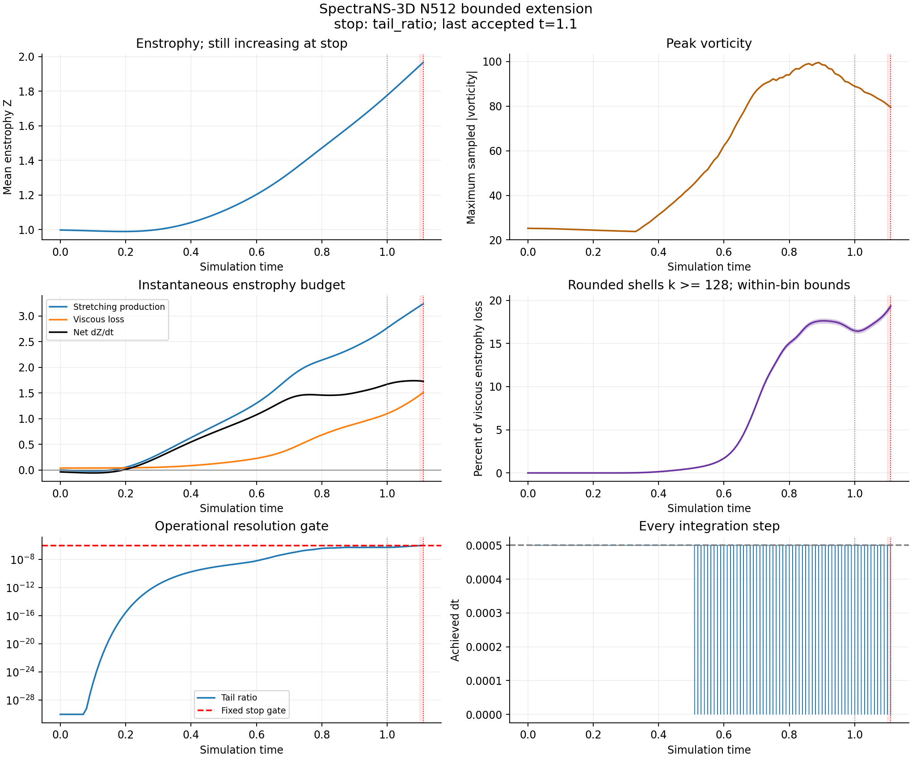

# SpectraNS-3D: bounded N512 enstrophy extension

Instance 55300356 destroyed; provider absence verified. Campaign: bounded_evidence_collected.
GPU tests: 107 passed in 3.51s. All 54 collected result-file hashes verified.

## Outcome

Stop reason: tail_ratio.
Last accepted t=1.1; terminal t=1.11; turnover bracket=None.

Last accepted Z=1.94855218; production=3.19521309; viscous loss=1.46048967; net dZ/dt=1.73472343.
k>=128 viscous-enstrophy-loss share=18.78042% (rounded-bin bounds 18.53173–19.03164%).
Tail ratio=9.36516024e-07; sampled peak Z={'t': 1.1, 'Z': 1.9485521793944034}; sampled peak vorticity={'t': 0.89, 'wmax': 99.60383637580676}.

Failed sample preserved: {'step': 2281, 't': 1.11, 'dt': 1.1102230246251565e-15, 'E': 0.06491489518355846, 'Z': 1.965865680106891, 'eps': 0.001965865680106891, 'dEdt_fd': -0.001957215104399222, 'budget_resid_rel': -3.154823422630949e-06, 'wmax': 79.50399461217036, 'bkm': 64.09088618654701, 'tail_ratio': 1.0173452870273713e-06, 'div_max': 2.3459888534058287e-14, 'wall_s': 1522.213750084862, 'peak_mem_GB': 23.201061376}.
The preceding accepted sample is an operational gate boundary, not a spatial-convergence certificate. The failed state is excluded from physical conclusions.

## Local temporal comparison

{
  "status": "passed",
  "start_t": 1.0,
  "end_t": 1.1,
  "matched_events": 11,
  "maximum_relative": {
    "E": 1.4763770630839686e-12,
    "Z": 2.945677837500872e-10,
    "wmax": 2.530026394655061e-08,
    "bkm": 1.065903732953264e-09,
    "spectrum_L1_fraction_E": 4.074820635827584e-12
  },
  "net_production_scaled_error": 8.549490459405916e-10,
  "effective_step_ratio": 1.9047619047619047,
  "scope": "local continuation error from identical coarse checkpoint; no accumulated-error or spatial claim"
}
The comparison measures continuation error from an identical coarse checkpoint. Common inherited pre-window temporal error is not measured.

## Runtime and spending

Coarse steps=2281; wall seconds=1531.7038247357123; dt statistics={'min': 9.992007221626409e-16, 'max': 0.0005, 'cfl_limited_steps': 0, 'event_limited_steps': 61}.
Allocator memory={'peak_allocated_GB': 23.201061376, 'peak_reserved_GB': 24.308088832, 'free_GB': 60.05424128, 'total_GB': 85.019590656, 'gpu': 'NVIDIA H100 80GB HBM3'}; sampled driver peak fraction=0.29192363810247796.
Collected checkpoint bytes=9701426304; two recent regular checkpoints plus terminal retained. Earlier field hashes remain in checkpoint_history.json.
A gate-failing terminal field is diagnostic evidence; use accepted regular fields for restart.
Project posted expenditure=USD 17.437; pending reserve=USD 1.277; hard project ceiling=USD 30.

## Scientific scope

A tail trip before turnover leaves the enstrophy maximum unresolved at N512. Grid refinement must test a later horizon; passing a tail heuristic alone cannot establish spatial convergence.
A finer run from a coarse checkpoint is a separate transfer experiment. Full-trajectory spatial convergence requires the original initial condition or explicitly validated history.
Exact commands, initial tube defaults, domain/dealiasing, runtime versions, audited source and control hashes are in configuration_record.json. Full spectra, budgets, every achieved timestep, checkpoint hashes, runtime, billing and termination evidence remain in native WSL.
No larger grid was launched.

## Growth-rate maximum and proposed follow-up

The sampled maximum instantaneous net production is 1.7391462
at t=1.08; it declines to 1.734723426 at t=1.10, where Z is still rising.
The late growth-rate maximum is not an enstrophy turnover. The last-interval estimated
curvature is -0.370201335, now negative.

The first closed attempt 55299122 failed before simulation due to the wrapper's missing
CUDA index. Its 105 GPU tests/references and failure logs are preserved. The corrected
run passed 107 GPU tests and all backend/checkpoint validations. After closure a reserve
bookkeeping test was added; the full current local suite passes 108 tests. Solver hashes
and all 46 supplied files remain unchanged. These test counts refer to different stages.

Project-parent posted charges for the two extension attempts: {55299122: 0.27, 55300356: 1.507}; sum USD 1.777.
Posted total project expenditure is USD 17.437; pending upper reserve
USD 1.277; uncommitted headroom USD 11.286.
The shared committed extension bound remained below USD 4.

The uncompressed checkpoint transfer was slow. All 53 original GPU result-file hashes
were verified after lossless alternative collection (1.508 GB compressed, 9.701 GB
checkpoint arrays). The redundant raw transfer was interrupted only after complete
collection; the instance was destroyed and absence verified. Original controller state
and collection_resolution.json preserve this operational history. The advanced local
manifest now contains 54 files, including the preserved pending termination record.

Recommend one bounded N640/H100 experiment from the original IC at cap 0.0005,
through t=1.5 or the first unchanged gate, plus a short terminal cap-0.00025 comparison.
Use a USD 5 all-in commitment only after actual N640 memory/runtime preflight and
fresh quotes/billing. This is a proposal, not a launched or validated N640 run.
The conservative driver-memory cubic forecast is 56.88 GB;
reserved forecast is 47.48 GB. The larger prior driver
sample is used because this extension sampled a lower driver peak. Passing a memory
forecast does not replace an actual preflight. The present usable H200 quote of about
USD 4.27/hour makes N640 the economical next comparison; it does not settle convergence
by itself. N768/N1024 have not been launched.

