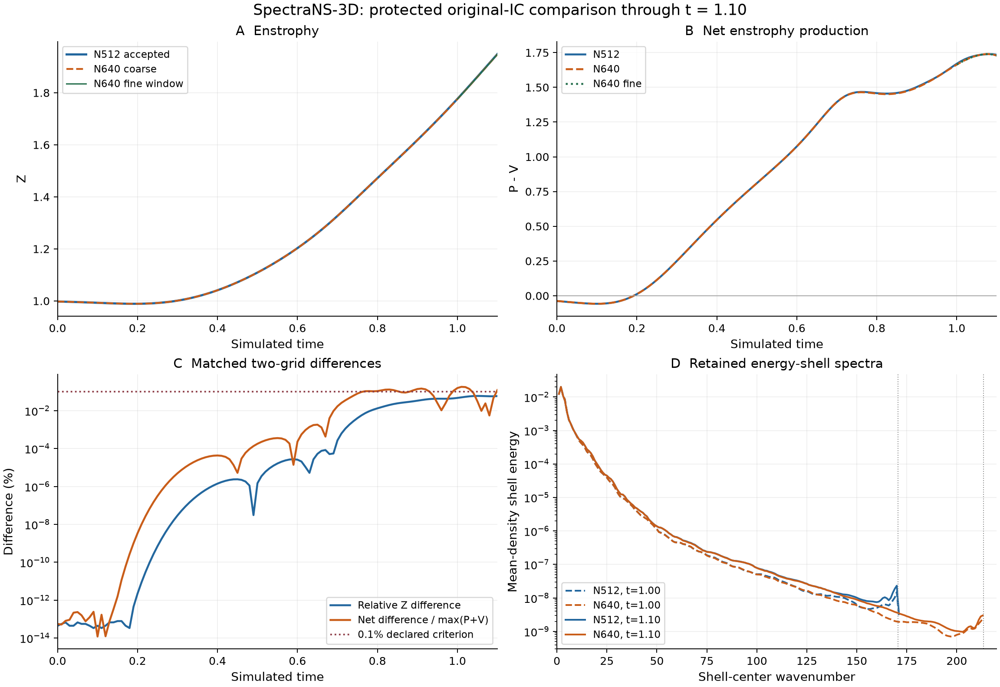

# N640 protected comparison — October 13, 2026

The original-initial-condition N512/N640 comparison through **t=1.10 is complete**, with independently verified numerical gates, the required N640 fine window and protected evidence. The result is mixed: enstrophy meets the declared 0.1% two-grid criterion, while scaled net production and the matched local vorticity estimate at t=1.00 do not. **Spatial convergence is not established.**

The single authorized H100 rental is destroyed and its absence independently verified. Posted campaign charges at the fresh 23:47:49 UTC reconciliation are **USD 2.895**; its conservative upper bound is **USD 3.463249**, below the USD 5 cap. The follow-up is paused. [Financial summary](evidence/2026-10-13/n640_campaign_004/financial_summary.json).

## Frozen experiment and execution

Unforced tubes in a periodic cube of side 2pi, original analytic parameters gamma=5, a=0.25, sep=0.6, pert=0.35; nu=0.0005; N640; float64/complex128; audited LSRK4; CFL 0.2; strict spherical |k|<N/3. Coarse cap 0.0005, events every 0.01, checkpoints every 0.1. All spectra, sampled maxima and budgets remain at every event; Fourier estimates use the predeclared subset. [Frozen scientific specification](../configs/n640_refinement_proposal.json).

Offer 49864346 supplied one H100 SXM, with a GPU-plus-storage bound of USD 2.093333/hour. Instance 55821344 began October 13 at 15:17:07 PDT and closed at 16:42:03 PDT, about 84.93 minutes. The independent ownership/deadline/account-credit guard armed before create. Maximum lifetime 7200 seconds; immutable image and transport/bootstrap hashes are retained in the [campaign summary](evidence/2026-10-13/n640_campaign_004/campaign_summary.json).

All 192 H100 tests and eight CPU/H100 references passed. Same-host N512 integration measured 0.595434 seconds/step; N640 warmup-discarded ordinary-step median was 1.446923 seconds. Diagnostics, selected Fourier estimates and checkpoint writes were timed separately. Protected work forecast 5338.54 seconds, including 25% compute margin and 180-second collection allowance, against 6318.28 seconds available: admission passed.

The original analytic-IC preflight 0–0.05 was retained and continued from its exact same-grid 0.05 checkpoint. The separate 0.051 reload-test state was never used for production. Prefix assembly verified the boundary and preserved the phase originals. The complete coarse record has 111 diagnostic events and 2200 steps. Sixty clock snaps, each at most 1.11e-15, avoided the historical tiny corrective steps; coarse minimum dt remained 0.0004999999999999449 with no CFL-limited steps. Finite-difference budgets use diagnostic intervals, not the last step's dt.

## Local temporal result

From the N640 t=1.00 anchor, the fine continuation to 1.10 used cap 0.00025: 400 steps versus 200 coarse steps, ratio 2.0. All eleven matched events passed the predeclared 1e-5 comparison.

| Metric | Maximum observed relative/scaled difference |
|---|---:|
| Energy | 1.7512e-12 |
| Enstrophy | 4.2941e-10 |
| Grid peak vorticity | 1.4253e-8 |
| Sampled-vorticity time integral | 8.9999e-10 |
| Net production scaled by production plus viscous loss | 2.1520e-9 |
| Full-shell spectral L1 difference / energy | 2.5512e-12 |

This validates local continuation sensitivity, with shared inherited error at the anchor. It does not measure nonlinear integration order, independently bound the entire N640 prefix's time error, or certify later-time dynamics.

## Two-grid result

Scalar differences divide by the larger magnitude of the two values. Net differences divide by the larger production-plus-viscous-loss magnitude; the spectrum metric is full-shell L1 difference divided by the larger energy. Only matched accepted events 0–1.10 are used.

| Observable | Maximum difference | Time | Declared interpretation |
|---|---:|---:|---|
| Enstrophy Z | 0.059970% | 1.05 | Within 0.1% criterion |
| Scaled net production | 0.181614% | 1.01 | Intermediate sensitivity: above 0.1%, below 1% |
| Energy | 0.000340% | 1.10 | Secondary criterion passed |
| Full-spectrum L1/E | 0.002664% | 1.10 | Secondary criterion passed |
| Grid-sampled peak vorticity | 2.598459% | 0.89 | Secondary 1% screen crossed; sampling remains a qualification |
| Sampled-vorticity time integral | 0.630717% | 0.95 | Secondary criterion passed |

The primary integral-curve classification is **intermediate sensitivity**, not a percent-level discrepancy or a spatial-resolution certificate. A matching endpoint or a matching net-production maximum alone would hide the larger differences elsewhere in the curves.

| Stable Fourier local estimate | N512 | N640 | Difference | Classification at 0.1% |
|---|---:|---:|---:|---|
| t=1.00 | 89.744883 | 89.310607 | 0.483900% | Discretization-sensitive |
| t=1.10 | 80.758513 | 80.765868 | 0.009107% | Consistent |

Both matched estimators passed their declared seed/search stability checks. These are local Fourier estimates, not certified global suprema. Their sampling biases were 0.9274%/0.2390% at 1.00 and0.1496%/0.0449% at 1.10 for N512/N640 respectively.

N512's sampled maximum 99.603836 occurred at 0.89; N640's sampled maximum 97.222958 occurred at 0.86. The largest stable N640 local estimate among the 31 selected events was 97.957955 at 0.87, with 0.8549% sampling bias. N640 estimates at 0.70 and0.89 were flagged unstable; the0.89 last-level increment 1.28e-5 exceeded the predeclared 1e-5 stability threshold. They are preserved without being promoted to accepted refined peaks. No N512 field exists at 0.89, so its interpolation bias and a paired refined-peak comparison cannot be recovered.

Supplementary 3/5-event quadratic net-peak fits gave times 1.080646 and 1.076265, difference 0.004381, and a fitted-value difference 0.027970%. Their declared fit-sensitivity comparison is **inconclusive**; it is neither a statistical confidence interval nor a gate that overrides the primary curves.



The dotted horizontal line marks the 0.1% curve criterion. The dotted spectral lines mark N/3; shell bins can straddle those cutoffs. Full spectra are preserved, although the plot displays their populated retained range. Outer-shell rises near each grid's respective cutoff are a truncation warning, not evidence for a particular physical mechanism.

## What the comparison establishes

Energy agreement is much stronger than agreement of derivative-sensitive observables. At t=1.00, N512/N640 stretching production is 2.766643/2.775856 and viscous enstrophy loss 1.096800/1.112121. The finer-grid loss is about 1.40% larger relative to N512, while net production is 1.669843/1.663736. Small energy differences therefore do not certify the stretching/dissipation balance or local vorticity peak.

The fixed-shell k>=128 loss-share center estimates are 16.454%/18.231% at 1.00 and 18.780%/20.545% at 1.10 for N512/N640. Associated shell-weighting bounds are retained. This fixed physical threshold occupies different fractions of the two retained ranges; it is not an identical outer-quarter statistic. Energy shares there remain only several parts per million. [N640 high-wavenumber records](evidence/2026-10-13/n640_campaign_004/protected/coarse/dissipation_shares.csv).

The tail gate passed through 1.10 on both grids, yet the t=1.00 stable local peak missed 0.1% agreement. That demonstrates the gate's limited role: it cannot certify every observable at that tolerance. Two grids do not identify the continuum error of N640, determine a convergence order, or justify recalibrating a threshold after seeing the result.

At 1.10, N640 Z=1.947402 and net production=+1.728983. Enstrophy was still rising; no turnover was observed. Falling pointwise peak vorticity together with rising enstrophy supports a broadening intensity distribution, without establishing sheets, reconnection or a core width. No regularity or blowup claim follows.

## Numerical and operational evidence

Independent arithmetic verified all 131 protected file hashes and reproduced the recorded classifications. Coarse maximum divergence was 2.52e-14, Parseval relative discrepancy 4.27e-16, interval-energy residual 2.48e-5 and instantaneous enstrophy-identity discrepancy 1.22e-14. The maximum coarse tail ratio was 1.399e-7. All frozen numerical gates passed.

N640 peaked at 47.433 GB allocated and 49.579 GB reserved. The sampled driver peak was 58.822% of its matching driver total; allocator fractions used their separate CUDA total. Each remained below 80%. Driver samples were periodic 0.25-second observations and cannot bound unsampled transients. The measured post-setup free-disk gate also passed. No larger grid was run.

Optional exploration began only after local protection. It advanced 20 steps toward 1.11 but accepted no diagnostic beyond 1.10. Its updated forecast required 1930.08 seconds plus 180 seconds reserve against 2064.27 seconds remaining, a 45.82-second shortfall. The worker refused continuation and the controller closed the owned instance. This was a runtime admission refusal, **not a numerical tail trip**. No N640 gate-trip time, later accepted trajectory or turnover is claimed.

No full N640 checkpoint arrays were downloaded, as predeclared. Metadata and component hashes are preserved; arrays were verified on the host and were lost when that host was destroyed. Hashes alone are not a recoverable restart state. Historical N512 fields and original archives remain intact.

At the final fresh reconciliation, project posted spending was USD 21.444, pending upper allowances USD 2.797991, other commitment USD 0: conservative exposure USD 24.241991 and headroom USD 5.758009 under the USD 30 ceiling. Provider posting can lag; those allowances remain private-ledger commitments until settled. Shared account credit and separate-job attribution are not published.

## Reanalysis and next scientific question

The [curated evidence manifest](evidence/2026-10-13/n640_campaign_004/evidence_manifest.json) links exact protected CSVs, spectra, configurations, runtime/source records, checkpoint metadata and sanitized financial/termination summaries. The original protected manifest is preserved separately from the final curated manifest.

From a clean project checkout, reproduce the independent assessment without a GPU:

```bash
python docs/evidence/2026-10-13/n640_campaign_004/independent_analysis.py \
  --campaign docs/evidence/2026-10-13/n640_campaign_004
```

The figure script and its isolated presentation-tool versions are included. They do not alter the validated simulation stack or recompute a trajectory.

This phase now supplies the planned reproducible two-grid answer, including its disagreements. The most informative further numerical study would add an original-IC N768 trajectory through the same common window and qualified temporal check, creating a three-grid sequence for derivative-sensitive observables. It requires a separately specified and authorized campaign, adequate measured memory/runtime and a fresh quote that fits the remaining project ceiling. It is **not asserted to be affordable from this headroom**, and no further rental is authorized or scheduled. This phase closes with unresolved continuum/spatial-convergence questions, rather than a claimed Navier–Stokes proof.
