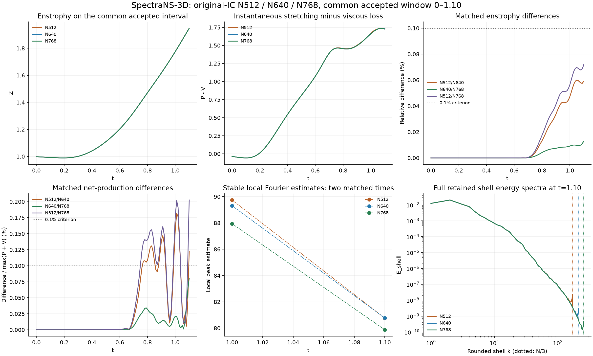

# Completed three-grid study: N512 / N640 / N768

October 13, 2026 PDT. The corrected N768/H200 campaign completed its original-initial-condition trajectory through **t=1.10**, its own-anchor fine 1.00–1.10 check, verified protected collection and owned-instance closure. Independent CSV arithmetic reproduced the controller's comparisons and passed the frozen numerical/memory checks. The N640/N768 integral curves meet the declared 0.1% criterion; stable local vorticity estimates remain sensitive at 1–2%. This is a completed finite-interval methodology study with unresolved continuum accuracy, not a regularity or blowup result.



## Experiment and provenance

Unforced analytic vortex tubes use gamma=5, core parameter a=0.25, separation=0.6, perturbation=0.35, viscosity=0.0005, periodic side 2pi, FP64 / complex128, audited LSRK4, solenoidal projection and strict spherical Fourier cutoff |k|<N/3. The coarse cap is 0.0005 with CFL 0.2; the own-anchor fine cap is 0.00025. Every 0.01 event has diagnostics, instantaneous enstrophy budgets and full shell spectra. Selected local Fourier searches follow the frozen schedule and retain performed/stability flags.

N768 began at the original analytic initial condition on this rental. Its exact own 0.05 preflight checkpoint continued into production; the independently hash-verified join preserves both phase originals. No N512/N640 field was transplanted. The combined trajectory has 111 events and 2249 integration steps, including legitimate CFL and event clipping. The required fine window used 200 coarse versus 400 fine steps.

The bound implementation is commit 338f77879dd905d5ea9c5cafd9e3ffeb842c0ad0; audited v3 core SHA256 is ab9eebda2750c7be019d3c2f54fe7aa5f2be98a0276a55260e35a81989b34842. Source/config bindings, immutable image and payload hashes are in the [execution summary](evidence/2026-10-13/n768_campaign_002/execution_summary.json) and [protected binding](evidence/2026-10-13/n768_campaign_002/protected/source_binding.json). Python 3.12.13, PyTorch 2.13.0+cu130, CUDA 13.0, cuFFT 12.0.0.61 and NumPy 2.5.1 are recorded exactly in [runtime packages](evidence/2026-10-13/n768_campaign_002/protected/runtime_packages.json).

239 H200 tests and eight CPU/H200 reference cases passed. The current preparation had239 local tests, eleven CPU/CUDA controller rehearsals including seven real SIGKILLs, and extracted235 passes / four CUDA-only skips. The [first N768 attempt](N768_PREFLIGHT_OUTCOME_2026-10-13.md) remains preflight-only, destroyed and published. Its cap-only operational admission assumption was corrected and rehearsed before this separately authorized attempt. No scientific timestep or numerical gate was loosened.

## Numerical and local temporal acceptance

The exact accepted N768 interval is 0–1.10; no first failing numerical event was observed. Both coarse and fine phases stopped at their declared simulated-time endpoint. No later-time exploration occurred.

The coarse maxima independently reconstructed from the small evidence are: divergence 2.01769e-14, energy tail 2.39937e-8 against 1e-6, Parseval relative residual 2.13592e-16, interval energy finite-difference residual 2.48235e-5 against 1%, and enstrophy-budget identity residual 8.18840e-15 against 1e-8. Energy is dissipative under the declared checks. Passing these heuristics is not a continuum-resolution certificate.

The local fine comparison passed at all 11 matched events. Its largest specified relative/scaled difference is **1.64332e-8**, from sampled vorticity; Z differs at most 5.26192e-10 and scaled net production 4.69480e-9, below the 1e-5 criterion. The step-count ratio is exactly 2. The fine run shares inherited error at the 1.00 anchor: this does not bound the full N768 prefix's temporal error or measure nonlinear integration order. Earlier grids also have their own dated temporal evidence. Grid comparisons below remain finite-trajectory comparisons under this qualification.

## Three-grid comparisons on the common accepted interval

All pairs compare 111 exact event times over 0–1.10. N512's first excluded tail failure at 1.11 is preserved historically and excluded here. Relative differences use the larger absolute paired value; the net difference uses max(P+V) as its scale. The frozen primary curve tolerance is 0.1%; discrepancies between 0.1% and 1% are classified intermediate, and percent-level primary differences material.

| Pair | Max relative Z | Max scaled net | Max relative energy | Spectrum L1/E | Primary curve classification |
|---|---:|---:|---:|---:|---|
| N512 / N640 | 0.059970% | 0.181614% | 0.000340% | 0.002664% | intermediate sensitivity |
| N512 / N768 | 0.071799% | 0.202581% | 0.000409% | 0.002801% | intermediate sensitivity |
| N640 / N768 | 0.012790% | 0.080435% | 0.000069% | 0.000530% | consistent at declared tolerance |

The closest pair meets both primary curve criteria. Energy and shell energy spectra agree substantially more closely than net production. N512/N768 remains intermediate on the net curve. These classifications concern specified observables and this accepted window; they do not imply that every derivative-sensitive quantity is converged.

## Local vorticity and sampling

All three local Fourier estimators pass their declared search-stability checks at the matched 1.00 and 1.10 fields.

| t | N512 estimate | N640 estimate | N768 estimate | N640/N768 difference | N512/N768 difference |
|---|---:|---:|---:|---:|---:|
| 1.00 | 89.74488312 | 89.31060746 | 87.94371821 | 1.530489% | 2.006983% |
| 1.10 | 80.75851307 | 80.76586802 | 79.87242341 | 1.106216% | 1.097209% |

N640/N768 fails the 0.1% local-peak consistency criterion at both matched times. N512/N640's very close 1.10 result therefore did not establish convergence: the third grid shifts that estimate by about1.1%. At 1.00 the newer local-peak increment grows rather than shrinks. These are stable local searches, not certified global suprema, and estimator stability is not an error bound.

N768's sampling bias is 0.263701% at 1.00 and 0.035222% at 1.10, materially smaller than these grid-associated local-estimate differences. Sampling alone does not explain the observed endpoint discrepancy within this estimator's scope. The maximum matched sampled-omega difference is 1.554845% for N640/N768, a secondary screen with a 1% threshold. BKM's corresponding secondary difference is 0.178144%. The grid-sampled maximum and BKM integral are not certified continuum quantities.

N768's sampled peak is 98.596944 at 0.88. The largest stable local estimate among the selected N768 events is 98.685024 at 0.88; the selected schedule cannot establish a global-in-time supremum. No retained N512 field exists at its historical sampled 0.89 peak. Unperformed searches are not failed stability tests; performed unstable searches remain flagged in the CSV.

## Budgets, spectral warnings and refinement trends

At 1.10 N768 has Z=1.9471531464 and P-V=+1.7252026872: enstrophy remains increasing. Its sampled net-production maximum in this window is 1.7380458191 at 1.07. Supplementary three/five-event quadratic fits give an N768 vertex near 1.07361, versus N512 1.08065, with heuristic time-sensitivity radii 0.005 each; this fit is supplementary and its paired verdict is inconclusive. A sampled net-production maximum is not the enstrophy maximum or a global episode maximum.

For N768, rounded shells k>=128 carry 18.7421% of viscous enstrophy loss at 1.00 and 20.9943% at 1.10, while their energy shares are 5.19084e-6 and 8.23319e-6. The same fixed threshold has different fractions of the retained range on different grids. The N768-specific k>=192 outer-quarter proxy carries 5.0022% and 4.4725% of loss respectively. These use the declared shell-center convention; low/high weighting bounds are in the CSV. The tiny energy tail coexists with sensitive local vorticity estimates, reinforcing observable-specific calibration.

Signed Z/P/V/net increments are retained for every matched event. Their signs and magnitude ratios need not be monotone. Early increments can be at roundoff or temporal-error scales and must not be counted as evidence of an asymptotic rate. Unequal refinement ratios 1.25 and 1.20, and a shrinking second increment by themselves, do not establish an order or continuum error bound. No Richardson-extrapolated singularity or continuum maximum is reported.

## Runtime, memory and financial closure

The measured admission forecast was 7570.23 seconds including 25% compute margin and 180 seconds collection reserve, versus 9811.89 seconds available. Actual controller start to verified termination was **95.6004 minutes**. Combined prefix/continuation wall time was 4349.00 seconds, with 3784.04 seconds integration,274.83 seconds checkpoint writing/hashing/pruning and 130.53 seconds local Fourier work. The fine process took 711.86 seconds. A 20-step same-host N512 benchmark measured 0.326679 seconds/step; this short benchmark is not an end-to-end runtime promise.

N768 allocator peaks were 81.9159 GB allocated and 85.6078 GB reserved against matching CUDA total 150.1120 GB: 54.570% and 57.029%. Sampled driver peak was 57.278% using its own matching denominator. All passed the 80% gates. Driver samples every 0.25 seconds cannot bound unobserved transient peaks. The valid N768 measurements do not rehabilitate the invalid historical 1024 allocation.

Owned instance 55858324 was destroyed; an independent complete provider listing confirmed absence. The temporary Windows sleep lease released. No other account instance was modified. Fresh parent-charge reconciliation at 05:14:35 UTC records:

| Financial quantity | USD |
|---|---:|
| Corrected campaign posted | 7.162 |
| Corrected campaign conservative upper | 7.539023 |
| Authorized corrected cap | 14.00 |
| Total project posted | 29.580 |
| Retained project pending upper allowances | 3.740349 |
| Total conservative project exposure | 33.320349 |
| Remaining below 40 project ceiling | 6.679651 |

Posting can lag; conservative allowances are retained rather than equated with an invoice. Parent charges are counted once, separate Digital Brain charges excluded by exact private attribution, and shared account credit is not project headroom. No additional paid run is authorized by this report.

## Reanalysis, preservation and release scope

All 132 protected manifest entries were independently hash-verified. The [curated evidence manifest](evidence/2026-10-13/n768_campaign_002/evidence_manifest.json) identifies original-byte evidence, independently replayable arithmetic, figures, exact field hashes and sanitized financial/resource records. Original local histories and archives are intact.

From a checkout, run the CPU-only analysis without a cloud job:

```bash
python docs/evidence/2026-10-13/n768_campaign_002/independent_analysis.py   --campaign docs/evidence/2026-10-13/n768_campaign_002
```

The script first verifies the protected manifest and frozen reference/config hashes, reconstructs numerical/temporal checks, compares all three pairs, and writes independent_assessment.json. Plotting is separate: use the recorded Matplotlib/NumPy versions and plot_comparison.py with the same --campaign argument. Figure metadata/SVG identifiers need not be byte-identical across plot executions; the published original figure hash is preserved.

No raw N768/N640 arrays were downloaded. Checkpoint metadata/component hashes prove recorded identity but cannot reconstruct a restart field, independently repeat field interpolation or support new geometry analysis. N512 endpoint estimates rely on its separately recorded retained-field analysis. Their raw arrays are outside the public package. Private credentials, account context, billing payloads and the live ledger are not published.

The planned finite-window release is complete: validated backend and operational workflow, three-grid comparison, observable-specific sensitivity, replayable small evidence and verified closure. Continuum accuracy of local peaks, a converged enstrophy turnover, physical geometry and a mathematical regularity/blowup result remain unresolved. The contribution is distinct measured numerical methodology for these unforced viscous tubes; it is not superiority to OpenAI's different forced analytical claim. See [research contribution](RESEARCH_CONTRIBUTION.md).
