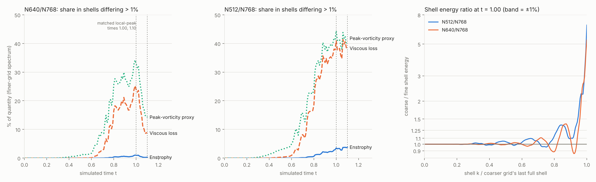

# Spectral resolution addendum: why integrals agree and local peaks do not

October 14, 2026. Post-hoc analysis of the completed [three-grid study](N768_THREE_GRID_COMPARISON_2026-10-13.md). No new simulation was run, no campaign evidence was modified, and no claim in the original reports is changed.

The three-grid study found that N640/N768 enstrophy agrees within 0.0128% while stable local Fourier vorticity estimates differ by 1.53% at t = 1.00 and 1.11% at t = 1.10. This addendum asks where in wavenumber space the grids disagree, and whether that location accounts for the difference between integral and local agreement.



## Inputs

The analysis reads only the three accepted coarse shell spectra over the common interval 0 ≤ t ≤ 1.10 (111 matched events). Each file's SHA256 is checked against its published binding before any arithmetic: N512 against [configs/n512_interpolated_peak_reference.json](../configs/n512_interpolated_peak_reference.json), and N640/N768 against their protected collection manifests. N512's excluded t = 1.11 event is filtered out. The spectra are shell sums of kinetic energy over rounded shells; only fully populated shells (k ≤ 170, 212 and 255) are compared.

## Method

For each grid pair and event, the coarser grid's shell energy is divided by the finer grid's at every shell the coarser grid fully resolves. A shell counts as **disagreeing** when the ratio differs from 1 by more than 1%. The finer grid's spectrum then supplies three weightings of those shells:

| Weighting | Shell weight | Why it matters |
|---|---|---|
| Enstrophy | k²E(k) | Integral quantity the study found well converged |
| Viscous enstrophy loss | k⁴E(k) | Enters scaled net production, found intermediately sensitive |
| Peak-vorticity proxy | k²√E(k) | From ‖ω‖∞ ≤ Σ\|ω̂(k)\|: a shell's largest possible contribution to a local maximum |

The proxy is a heuristic upper-bound weighting, not a measured error. It shows which shells are able to move a local maximum, assuming their phases align.

## Findings

**1. Disagreement concentrates where local peaks are sensitive and integrals are not.** Between N640 and N768:

| t | Enstrophy in disagreeing shells | Viscous loss | Peak proxy | Peak proxy above N640 cutoff | Local-peak difference (study) |
|---:|---:|---:|---:|---:|---:|
| 0.88 | 0.55% | 19.2% | 27.6% | 8.9% | not matched |
| 1.00 | 0.98% | 23.9% | 32.8% | 7.9% | 1.53% |
| 1.10 | 0.29% | 8.7% | 14.3% | 7.0% | 1.11% |

Under 1% of enstrophy sits in shells where the grids disagree, consistent with 0.0128% enstrophy agreement. A fifth to a quarter of viscous loss does, consistent with net production being the more sensitive curve. A third of the peak proxy does, plus a further 7–9% in shells N640 cannot represent at all. All three N640/N768 fractions reach their maximum at t = 0.99, where the study's matched local-peak difference is largest. Between t = 1.00 and 1.10 the proxy fraction falls from 32.8% to 14.3% while the local-peak difference falls from 1.53% to 1.11%. The direction agrees; two matched times cannot calibrate a relationship.

**2. N512 is markedly less resolved than N640 during the intense phase.** For N512/N768 at t = 1.00 the corresponding shares are 3.5% (enstrophy), 41.0% (viscous loss) and 44.4% (proxy), with 17.6% of the proxy above N512's cutoff. Before t = 0.5, the proxy share in disagreeing shells stays below 1% for N640/N768 and below 3% for N512/N768; it grows sharply from about t = 0.6. The earlier 0.009% N512/N640 agreement of the local peak at t = 1.10 occurred while about 40% of the proxy sat in disagreeing shells, which supports the study's conclusion that it was coincidental rather than converged.

**3. Grids depart well inside their cutoff, and pile energy up at it.** At t = 1.00, N640 first departs from N768 by more than 1% at shell 83 (0.39 of its last full shell) and by more than 10% at shell 151 (0.71). The coarser grid's last full shell holds 5.3 (N640) and 6.8 (N512) times the energy the finer grid has there. That accumulation is already present at t = 0.3 (ratio 3.8 for N640), so it is a persistent truncation-edge feature, and it carries only about 10⁻⁷ of the coarse grid's energy. It inflates the proxy near the cutoff, which is part of why local maxima are more fragile than energy-weighted integrals.

## A negative result: the strip-width fit is not reliable here

The conventional analyticity-strip fit ln E = c − n ln k − 2δk was applied over nine fitting windows per grid and time (lower edge 0.3/0.4/0.5 and upper edge 0.8/0.85/0.9 of the last full shell). It is too window-sensitive to serve as a resolution certificate for these spectra:

| Grid, t | δ (nominal 0.4–0.9 window) | δ range over windows | Note |
|---|---:|---:|---|
| N768, 0.88 | 0.0101 | 0.0066 – 0.0138 | |
| N768, 1.00 | 0.0110 | 0.0053 – 0.0178 | range spans a factor of 3.4 |
| N768, 1.10 | 0.0236 | 0.0214 – 0.0247 | fitted n = −0.50, unphysical |
| N512, 0.88 | 0.0149 | −0.0231 – 0.0149 | range includes negative δ |

The power-law and exponential terms trade off within any finite window, and shell-to-shell structure (log-residual RMS 0.04–0.09) dominates the curvature the fit needs. The fitted values are published in `strip_fit.csv` with their window ranges. They are not used to support any finding above, and quick single-window estimates of k_max·δ made during exploration should not be cited.

## Limits

- Shell spectra discard phase and position. They show which wavenumbers can move a local maximum, not where in space it is or by how much it moves.
- The 1% shell threshold is a fixed analysis choice, applied identically to every pair and time. It is not a calibrated tolerance.
- No full N640 or N768 velocity field was downloaded, so peak geometry and phase alignment cannot be checked.
- This analysis does not establish continuum accuracy, a convergence order, or an error bound for any quantity.

## Reproduce

CPU-only, numpy only, no cloud access. From a checkout:

```bash
python analysis/spectral_resolution.py --output docs/evidence/2026-10-14/spectral_resolution
python -m pytest -q analysis
```

The first command verifies all three input hashes and writes `grid_disagreement.csv` (every pair and event), `strip_fit.csv` and `summary.json`. The tests check exact recovery on synthetic spectra, reject a tampered input, and confirm that a fresh run reproduces the published summary. The figure needs matplotlib, which is outside the locked simulation environment: `python analysis/plot_spectral_resolution.py --output docs/evidence/2026-10-14/spectral_resolution` (made with matplotlib 3.11.2).

The analysis lives in `analysis/`, outside `src/`, `scripts/` and `tests/`, so the campaign source fingerprint is unchanged.
