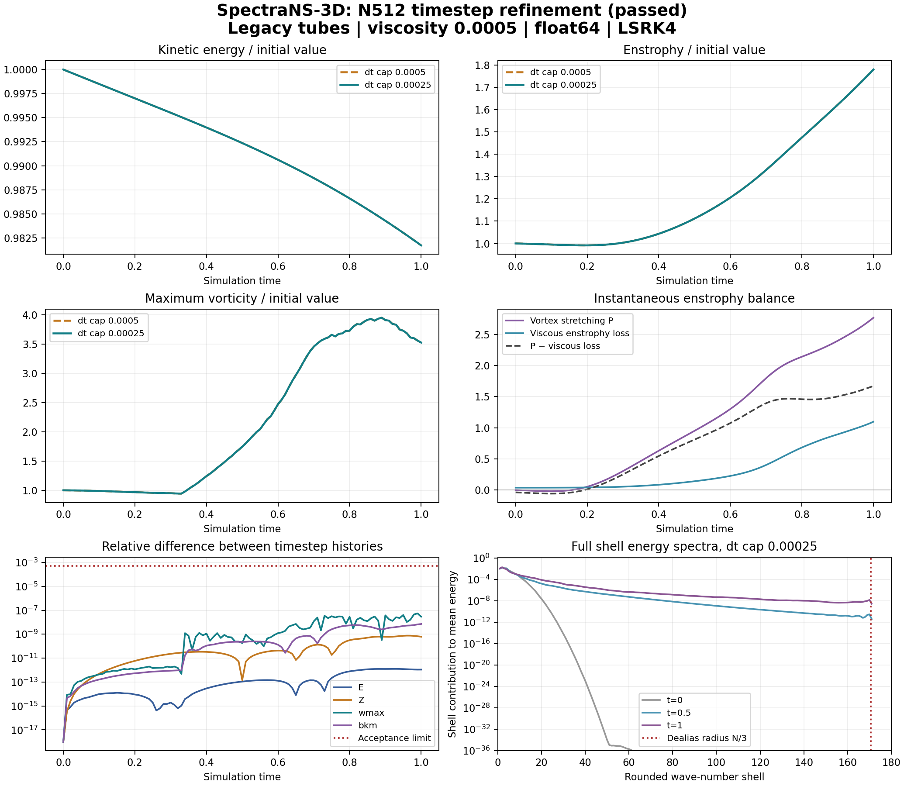

# SpectraNS-3D: N512 timestep validation — 2026-10-10

The fixed N512 timestep-refinement experiment passed to t=1.
Instance **55290425** was destroyed; complete provider listing and downloaded artifact hashes were verified.
The independent analysis verified **41 result-file hashes**.
Historical sources and results remain preserved. The authoritative checkout is /home/manager/spectrans-3d.

## Exact experiment

| Parameter | Value |
|---|---|
| Initial condition | Audited legacy vortex tubes; periodic cube of side 2π; unforced |
| Grid | N512; short N256/N512 preflights first |
| Viscosity | 0.0005 |
| Precision / integrator | float64 / LSRK4 |
| Timestep caps | 0.0005 and 0.00025; CFL 0.2 |
| Target / diagnostics | t=1; exact shared output events every 0.01 |
| Spectra | Every shell at every diagnostic event; slab 4 |
| Enstrophy budget | Recorded at every diagnostic event |
| Spending / lifetime | $8 all-in cap; 9000 seconds maximum instance lifetime |

Each run has an exact command, parameter manifest, source hashes, runtime versions, diagnostics, complete shell spectra and memory metrics. The campaign has one-second driver samples, an independent destruction guard, source/payload fingerprints and a verified termination record.
Counts include short steps that land on diagnostic events.

## Numerical result

Both trajectories passed the fixed dissipation, divergence, tail, Parseval, enstrophy-identity and memory checks.
All 89 tests and the fresh eight CPU/H100 backend comparisons passed.

| Paired metric | Maximum relative difference | Declared limit |
|---|---:|---:|
| E | 1.25077e-12 | 0.0005 |
| Z | 7.55648e-10 | 0.0005 |
| wmax | 5.4357e-08 | 0.0005 |
| bkm | 7.09137e-09 | 0.0005 |
| spectrum_L1_fraction_E | 1.24907e-11 | 0.0005 |

Actual step-count ratio (fine/coarse): **1.9878**.
This establishes agreement for these two timestep choices on this grid and interval; it does not establish an observed integration order.

## Recorded dynamics

| Trajectory | End time | Steps | Runtime seconds | Peak ω | Time of peak ω | Energy loss |
|---|---:|---:|---:|---:|---:|---:|
| tubes_N512_coarse | 1 | 2050 | 894.516 | 99.6038 | 0.89 | 1.8282% |
| tubes_N512_fine | 1 | 4075 | 1746.483 | 99.6038 | 0.89 | 1.8282% |

The sampled vorticity maximum is 3.9525 times its initial value.
Final enstrophy is 1.7803 times its initial value.
Peak instantaneous net enstrophy production is 1.66984.
Energy can decrease while enstrophy and peak vorticity grow; the recorded stretching and viscous-loss terms quantify this redistribution toward smaller scales.
The observed finite-time episode is not evidence of a mathematical singularity.

At t=1, shells k>=128 contain only 0.000576% of kinetic energy, but account for approximately 16.454% of viscous enstrophy loss.
Using the rounded-shell geometric bounds gives 16.236% to 16.675% for that loss contribution.
This supplementary estimate uses the k^4 weighting of enstrophy dissipation for the solenoidal Fourier field. It is not a new acceptance criterion and does not by itself prove under-resolution; it motivates direct grid refinement.

## Memory and financial record

Sampled driver maximum: 34.253% of device memory.
The driver maximum is a one-second sampled peak, distinct from allocator high-water marks.

| Trajectory | Peak allocated GB | Peak reserved GB | Device total GB |
|---|---:|---:|---:|
| tubes_N512_coarse | 23.201061 | 24.308089 | 85.019591 |
| tubes_N512_fine | 23.201061 | 24.308089 | 85.019591 |

Quoted GPU-plus-disk upper rate: **$2.8800/hour**.
Provider-posted charge for this instance: **$2.242**.
Total posted project charges: **$15.565**.
Pending-charge upper reserve: **$0.754**.
Available account credit at reconciliation: **$14.532**.
The $30 total project ceiling remains in force. Posted charges can lag; the reserve remains in the ledger.

## Scientific limit and next experiment

Long-time spatial convergence is still unverified. Passing a spectral-tail heuristic and Parseval identity does not establish it.
The next most informative experiment is a fixed-physics N640 run at timestep cap 0.00025, compared at matched times with the completed N512 fine trajectory. It requires a same-configuration memory/runtime preflight, the existing numerical gates, a fresh provider quote and charge reconciliation.
A cubic extrapolation from N512 reserved memory gives about 47.5 GB at N640; this is a forecast, not a measurement. At N768 it gives about 82.0 GB, exceeding the H100 80% safety ceiling. No N768/N1024 run is authorized by this campaign.
The purpose of the next comparison is to test whether the stretching episode and its peak survive spatial refinement, especially because the N512 tail approaches its declared threshold.

## Reproduction and preserved evidence

The source payload archive, bundle manifest, approval, fixed numerical criteria, controller state, full raw CSVs, spectra, GPU trace, runtime checks, tests and verified termination record remain under this native campaign directory.
independent_analysis.json reproduces the numerical and physical summaries. figure_manifest.json binds the plotted input CSV hashes and plotting-library versions. Raw invalid historical runs remain historical evidence.

Audited numerical sources:

- ns_fast_v3.py: ab9eebda2750c7be019d3c2f54fe7aa5f2be98a0276a55260e35a81989b34842
- ns_fast_v2.py: 6f01107b931b80231e27336faeae94b51916d91861473f46e85aedbba0bdaf5d

