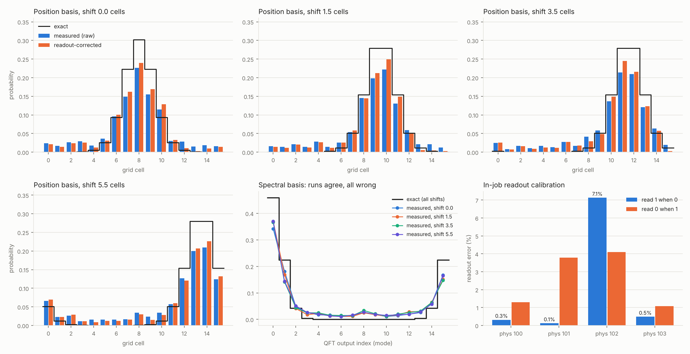

# Results: kingston_001 and its replication kingston_002

October 14, 2026. Two pre-registered runs of the same experiment on ibm_kingston, reported together as the [replication addendum](PREREGISTRATION_ADDENDUM_kingston_002.md) commits. Both bundles are committed unedited. The first run is analysed in detail in [RESULTS_kingston_001.md](RESULTS_kingston_001.md).

| | kingston_001 | kingston_002 |
|---|---|---|
| Physical qubits | [1, 2, 3, 16] | [100, 101, 102, 103] |
| Job | `db7s9kor1c5c738l705g` | `db7svfgr1c5c738l8d90` |
| Calibration at prepare | 10:27 PDT | 11:29 PDT |
| QPU time | 13 s | 13 s |
| Worst in-job readout error | **28.1%** (physical 1), flagged | 7.1% (physical 102), not flagged |
| Fitted depolarizing ε (shift-0 twin) | 0.19 (0.16–0.22) | 0.27 (0.25–0.30) |



## Verdicts

Values are point estimates with 95% multinomial bootstrap intervals. The pass fraction is across 2000 resamples.

| | Prediction | kingston_001 | kingston_002 |
|---|---|---|---|
| **P1** | Centroid within 0.25 cell | **PASS**: max 0.080 | **PASS**: max 0.139, at shift 3.5 |
| **P2** | Raw peak ≥ 5% low at every shift | **FAIL**: +7.6% at shift 1.5 | **PASS**: 20.7–25.2% low at every shift (pass fraction 1.00) |
| **P3** | Runs agree more with each other than with truth | **PASS**: 0.027 vs 0.253 | **PASS**: 0.065 vs 0.217 |
| **P4** | Twin-corrected peak within 7.5% | **FAIL**: up to +31.6% | **FAIL**: up to +14.0%, at shift 1.5 (pass fraction 0.01) |

## The replication question

The addendum asked whether P2 and P4 still fail on a path without kingston_001's readout fault, and fixed in advance what each outcome would mean. **P2 passed with no qubit flagged**: the outcome the addendum named as consistent with kingston_001's P2 failure having been driven by the qubit-1 fault.

The data support that reading directly. In kingston_001, the two cells that should be equal at each half-integer shift came out lopsided, with the odd-numbered cell winning every time (0.301 vs 0.170 at shift 1.5). That is the signature of a fault on the qubit holding the lowest index bit. In kingston_002 they come out balanced: 0.198/0.222, 0.214/0.210 and 0.200/0.209. With that fault gone, the noise behaves as predicted. Every peak is pushed down, by 21–25%, never up.

This rests on one run per path, at different calibrations, so it is consistent with the explanation rather than proof of it.

## P4 fails on both paths, for different reasons

P4 is the prediction the pre-registration flagged as the one that could plausibly fail. It did, both times. The cause differs, which is the more useful finding.

The twin correction assumes that one depolarizing ε, fitted to the shift-0 circuit, describes the other circuits too, since they share its gate structure. Each run can be checked by asking what ε would exactly explain each circuit's own readout-corrected peak:

| | Twin ε, fitted to all 16 cells at shift 0 | Peak-implied ε at shift 0 / 1.5 / 3.5 / 5.5 |
|---|---|---|
| kingston_001 | 0.190 | 0.114 / **−0.140** / 0.051 / −0.031 |
| kingston_002 | 0.272 | 0.260 / 0.140 / 0.160 / 0.248 |

- **kingston_001:** negative values mean a peak came out *above* exact even after readout correction. No amount of uniform mixing can do that. The error was structured, and dividing out ε amplified it.
- **kingston_002:** the twin is self-consistent (0.272 fitted vs 0.260 implied by its own peak). But the shifted circuits' peaks show only 0.14–0.25. The circuits differ only in single-qubit phase angles, yet their effective noise differs, so a twin that is right about itself over-corrects the others. The corrected peaks come out 2.6–14.0% high.

Taken together: **a known-answer twin with the same gate structure did not calibrate a local observable on either path.** On a device with a readout fault, the correction amplified the fault. On a clean path, the noise itself depended on circuit parameters the twin did not share.

## What the two runs show together

- **Integral observable.** The centroid survived on both paths: within 0.08 cell despite a 28% readout fault, and within 0.14 cell on a noisier but cleanly read path.
- **Consistent but wrong.** Runs agreed with one another far more closely than with the exact answer on both paths: TVD 0.027 vs 0.253, and 0.065 vs 0.217. That is the quantum counterpart of the three-grid lesson that agreeing runs can share their error.
- **Local observable.** Its error took either sign on the faulted path, and was consistently negative on the clean one. Which you get depends on the device's error structure, which is exactly what the integral observables are insensitive to.
- **Calibration of local values.** A single-parameter correction failed on both paths, for two different reasons.

These are two jobs on one device on one day. They say nothing about quantum advantage, Navier–Stokes regularity or OpenAI's result, and a laptop computes every exact value used here.

## Disclosures

- kingston_002 was motivated by kingston_001's outcome. Its path was fixed by a rule committed before submission, and nothing else changed.
- Kingston recalibrated between the backend audit used to choose the path and the kingston_002 run. The path was not re-chosen, as the rule required.
- The kingston_002 dry run on the newer calibration already failed P4, with 21% of resamples passing. The threshold was not changed.
- The readout-flag field was added after kingston_001. Re-scoring kingston_001 with it changes no verdict and flags its logical qubit 0 (physical 1).
- The plotting script's readout-panel labels were corrected to read the path from the manifest before the kingston_002 figure was made. kingston_001's figure was already correct and is unchanged.

## Reproduce

```bash
python quantum/run_qpu.py analyse --bundle quantum/runs/kingston_002
python quantum/plot_results.py --bundle quantum/runs/kingston_002      # needs matplotlib
```
